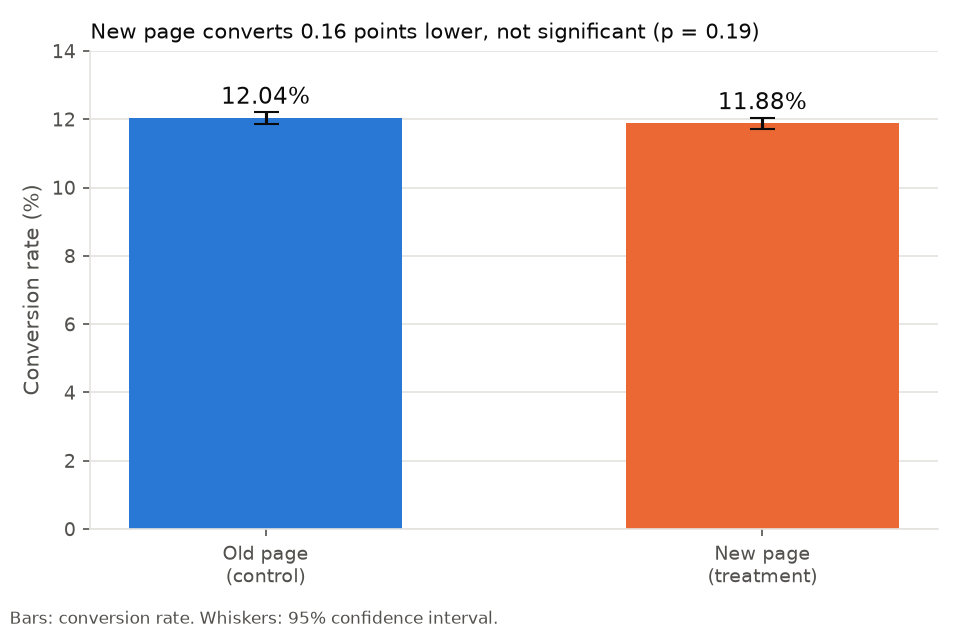
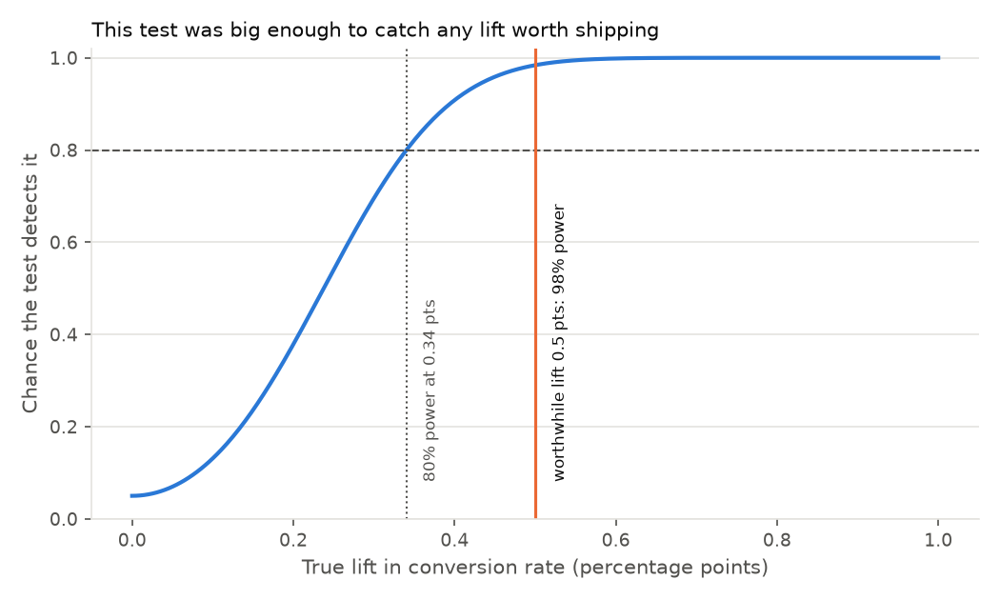
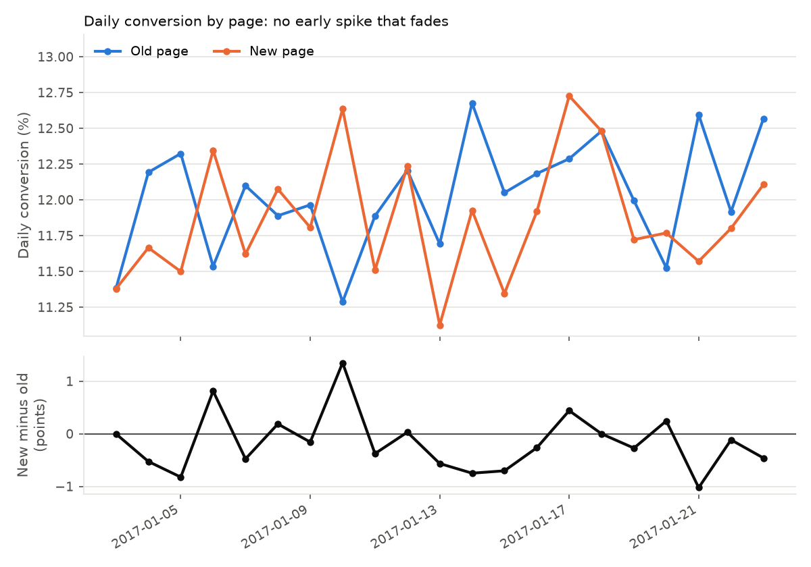

# Landing Page A/B Test Analysis

**Should we replace the current landing page with the redesign?**

A company tested a redesigned landing page against its current one by splitting
visitors at random. This project reads that test the way a growth team should
before rolling anything out: check the data can be trusted, measure the
difference, decide whether the difference is big enough to matter, and make a call.

**Recommendation: KEEP OLD PAGE.** The new page converted at 11.88% against 12.04%
for the old page. That is 0.16 points lower, and the gap is within
normal random noise. The test was large enough to spot a lift worth paying for,
and it did not find one.

## At a glance

| | Old page (control) | New page (treatment) |
|---|---|---|
| Visitors | 145,274 | 145,310 |
| Conversions | 17,489 | 17,264 |
| Conversion rate | 12.04% | 11.88% |
| 95% range for the rate | 11.87% to 12.21% | 11.71% to 12.05% |

| Result | Value |
|---|---|
| Change in conversion rate (new minus old) | -0.16 percentage points |
| Change relative to the old page | -1.3% |
| 95% confidence range for the change | -0.39 to +0.08 points (-3.3% to +0.6%) |
| Chance of a gap this size if the pages were truly equal (p value) | 0.19 |
| Smallest lift worth shipping (business input) | 0.5 points (4.2% relative) |
| Chance this test would have caught that lift | 98% |



## The data

`ab_data.csv` from the public [30lm32/ml-ab-testing](https://github.com/30lm32/ml-ab-testing)
repository: one row per page view with `user_id`, `timestamp`, `group`
(control or treatment), `landing_page` (old_page or new_page) and `converted`
(1 if the visitor converted). It holds 294,478 rows from 290,584 unique
visitors between 2017-01-02 and 2017-01-24.

That repository has no country file, so the planned country breakdown is skipped.

## Step 1: cleaning

Each group should only ever see its own page. Some rows broke that rule, which
means the tracking or the page routing misfired for those visits. We cannot
say which page actually influenced those visitors, so the rows are removed.

| What was removed | Rows | Why |
|---|---|---|
| Control visitors shown the new page | 1,928 | wrong page for the group |
| Treatment visitors shown the old page | 1,965 | wrong page for the group |
| Repeat visits by the same user | 1 | keeps one row per person (their first visit) so nobody is counted twice |
| **Total removed** | **3,894** | |

294,478 rows in, 290,584 rows out. Before cleaning, 3,894 rows
were repeat appearances of a user already in the data. Almost all of them were
the mismatched rows: those visitors had one correct visit and one wrong one.
After dropping the mismatches only 1 user still appeared twice. The
number of unique visitors lost in cleaning is 0, so every person in
the test is still counted once.

## Step 2: can the split be trusted?

- **Group sizes.** A 50/50 split should give nearly equal groups. We got
  49.99% old and 50.01% new. A chi square check on those counts gives
  p = 0.95, so there is no sign the randomizer was broken (a p value below
  0.01 here would be a red flag).
- **Test length.** 22 days, which covers three full weekly cycles, so
  weekday and weekend visitors are both well represented.
- **Daily split.** On every full day the new page got between 49.3% and
  50.5% of traffic. No day was lopsided.

## Step 3: the result

The new page converted -0.16 points differently from the old one (-1.3%).
The 95% confidence range for the true change runs from -0.39 to +0.08
points. That range includes zero, and the p value is 0.19 (a two proportion z
test gives z = -1.31), so the data does not show a real difference in either
direction. A bootstrap check gives almost the same range (-0.38 to +0.09
points).

## Step 4: is it worth acting on?

A statistically real lift can still be too small to justify the cost of
switching. We set the **smallest lift worth shipping**
at 0.5 percentage points, about 4.2% on top of the old page. That is
the business input in `src/run_analysis.py`; change it and the whole report
updates.

- With this many visitors, the test had a 98% chance of detecting a
  0.5 point lift if it existed. It would detect anything from
  0.34 points (2.8% relative) upward with 80% power.
- To detect a 0.5 point lift with 80% power you only need 67,676
  visitors per page, so this test was well above the size it needed.
- Even the most optimistic end of the confidence range (+0.08 points) is far
  below the 0.5 point bar.

So this is not a case of "too little data to tell". The test was strong enough,
and the best case for the new page is still not worth rolling out.



## Step 5: does the effect change over time?

New designs sometimes win early just because they are new (a novelty effect),
then fade. Over the 21 full days:

- The new page beat the old one on 6 of 21 days.
- Average daily gap: +0.00 points in the first half of the test and
  -0.32 points in the second half.
- The daily gap has no meaningful trend (-0.013 points per day, p = 0.53).

There is no early spike that fades, and no late surge that would justify waiting.



## Recommendation: KEEP OLD PAGE

1. The new page did not convert better: 11.88% against 12.04%, a gap well
   inside normal noise (p = 0.19).
2. The test was big enough to catch a 0.5 point lift 98% of the time,
   so the lack of a win is a real answer, not a sample size problem.
3. The best plausible outcome (+0.08 points) is still below the lift needed to
   justify switching, and the daily trend shows no hidden upside.
4. Keep the old page, and put design effort into a bolder variant rather than
   running this one longer.

## Reuse it on the next test

All of the statistics live in `src/ab_test.py`. For any one row per user
conversion table:

```python
from src.ab_test import analyze_ab_test

result = analyze_ab_test(
    df, group_col="group", conversion_col="converted",
    control="control", treatment="treatment",
    time_col="timestamp", mde_abs=0.005,
)
result["test"]        # rates, lift, confidence range, z test
result["srm"]         # group size check
result["power"]       # power and minimum detectable lift
result["decision"]    # ship / keep old page / keep testing, with the reason
```

The cleaning helpers (`remove_assignment_mismatches`, `deduplicate_users`) are
separate so they can be reused or skipped.

## How to run

```bash
python -m venv .venv
source .venv/bin/activate
pip install -r requirements.txt
python -m src.run_analysis
```

This downloads the data if it is missing, writes `reports/results.json`, the
three charts in `reports/figures/`, and regenerates this README from
`reports/README_template.md`. The notebook `notebooks/ab_test_analysis.ipynb`
walks through the same steps with outputs shown. The random seed is fixed at 42
(used by the bootstrap check), so every run gives identical numbers.

## Project structure

```
data/                          raw and cleaned data
notebooks/ab_test_analysis.ipynb   step by step walkthrough
src/ab_test.py                 reusable analysis functions
src/run_analysis.py            end to end pipeline and charts
src/render_readme.py           fills the README from results.json
reports/results.json           every number in this README
reports/figures/               charts
```
